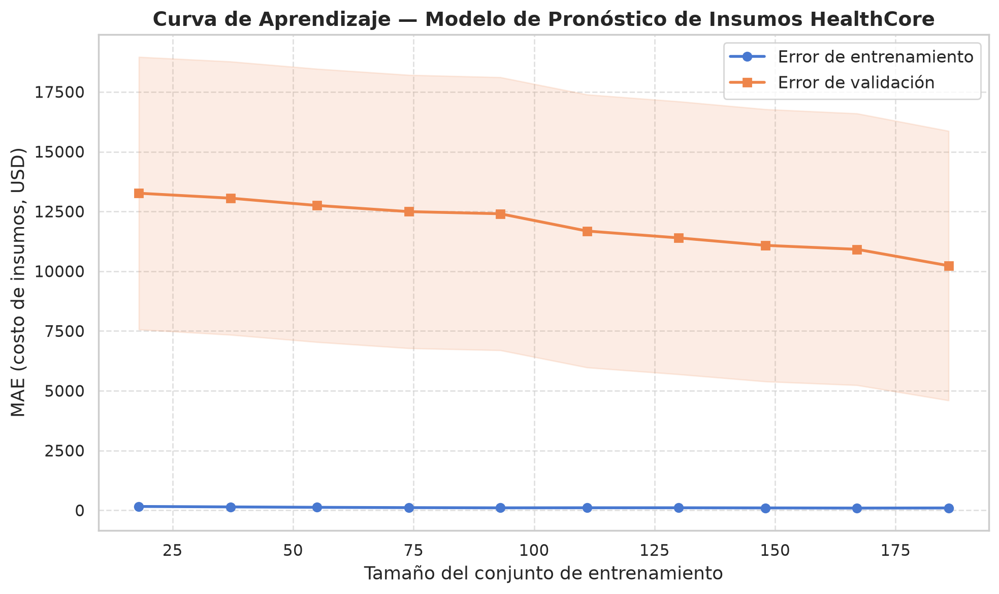

# Reporte de Evaluación Técnica — Modelo de Pronóstico HealthCore

**Fecha:** 2026-11-15
**Proyecto:** Evaluación de Modelo de Regresión (Pronóstico de Costo de Insumos)
**Modelo:** RandomForestRegressor (n_estimators=200, max_depth=12)
**Split temporal:** 8 años entrenamiento / 2 años prueba
**Dataset:** 12 clínicas, ∼126 meses cada una

---

## 1. Selección de Métrica Principal

**Métrica principal: RMSE  |  Métrica secundaria: MAE**

**Justificación:** Para HealthCore, **subestimar** el costo de insumos (y por
tanto el consumo) es más costoso que sobreestimarlo. Una subestimación
grave puede provocar desabastecimientos (*stockouts*) que afectan la
atención al paciente. El RMSE penaliza desproporcionadamente los errores
grandes (L2), alineándose con el costo asimétrico de los errores graves
de subestimación. El MAE se reporta como referencia secundaria.

> *Fuente: HealthCore BRIEFING — "subestimar las ventas de la temporada
> alta provoca desabastecimientos; los errores importantes resultan
> desproporcionadamente costosos."*

---

## 2. Validación Cruzada Temporal

**Método:** `TimeSeriesSplit(n_splits=5)` sobre el
conjunto de entrenamiento (fold cronológicos, sin shuffle).

| Fold | Train size | Val size | MAE (USD) | RMSE (USD) |
|------|-----------|---------|-----------|-----------|
| 1 | 186 | 186 | 2921.06 | 3514.46 |
| 2 | 372 | 186 | 1172.67 | 1643.34 |
| 3 | 558 | 186 | 2268.71 | 2938.36 |
| 4 | 744 | 186 | 1525.89 | 2128.55 |
| 5 | 930 | 186 | 1809.65 | 2324.21 |

**Resultados agregados:**

| Métrica | Media ± Desviación Estándar |
|---------|-----------------------------|
| MAE (CV) | 1939.59 ± 607.92 USD |
| RMSE (CV) | 2509.78 ± 651.70 USD |

La desviación estándar entre folds es de **651.70**
para RMSE y **607.92** para MAE. Esto indica una
varianza **moderada/alta** — el modelo muestra inestabilidad según qué porción del tiempo se use para entrenar.

---

## 3. Curva de Aprendizaje

**Interpretación:**

El error de entrenamiento es bajo (MAE=165) pero el error de validación es significativamente mayor (gap=1775, gap relativo=1077.7%). El modelo memoriza el ruido de entrenamiento y no generaliza.

**Patrón detectado:** **overfitting**

Existe una brecha amplia y persistente entre el error de
entrenamiento (bajo) y el de validación (alto). El modelo memoriza el
ruido de entrenamiento.

---

## 4. Diagnóstico

**Clasificación:** OVERFITTING

**Evidencia:**
El error de entrenamiento es bajo (MAE=165) pero el error de validación es significativamente mayor (gap=1775, gap relativo=1077.7%). El modelo memoriza el ruido de entrenamiento y no generaliza.

**Estabilidad (CV):** RMSE=2509.78 ± 651.70 USD.
La variabilidad entre folds es de 651.70 USD, lo que
representa un coeficiente de variación de
**26.0%**
sobre el RMSE medio.

---

## 5. Acción Correctiva Específica

Aplicar regularización: reducir `max_depth` (ej. 12→6–8), aumentar `min_samples_leaf` (ej. 1→10–15), o incrementar `min_samples_split`. Agregar más datos de entrenamiento también puede ayudar. No aumentar la complejidad como primera acción.

---

## 6. Métricas de Referencia (Train vs Test)

| Partición | MAE (USD) | RMSE (USD) |
|-----------|-----------|------------|
| Entrenamiento (8 años) | 164.69 | 243.53 |
| Validación (CV promedio) | 1939.59 | 2509.78 |

